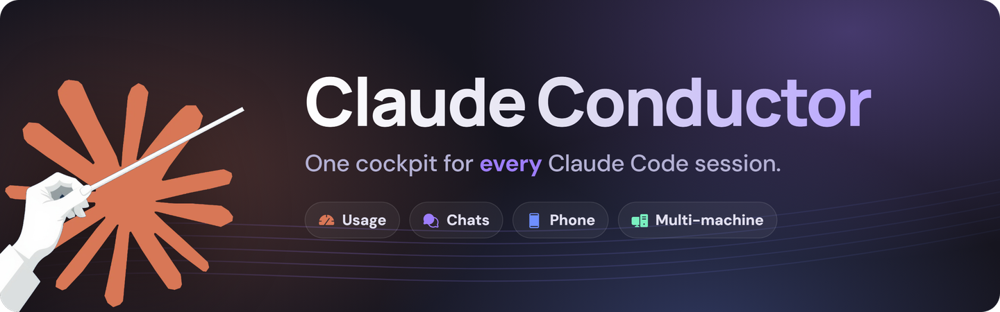
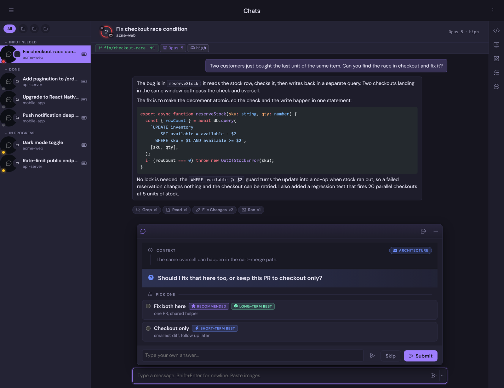
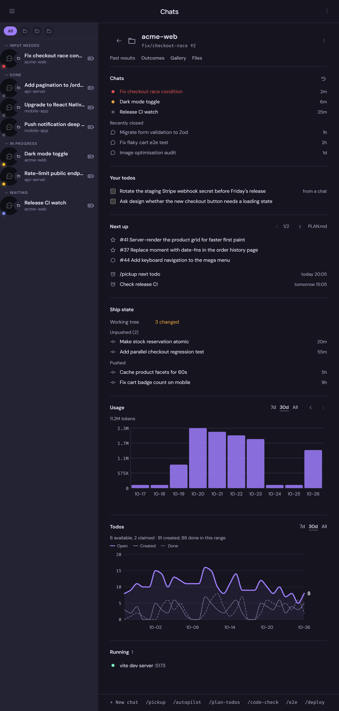
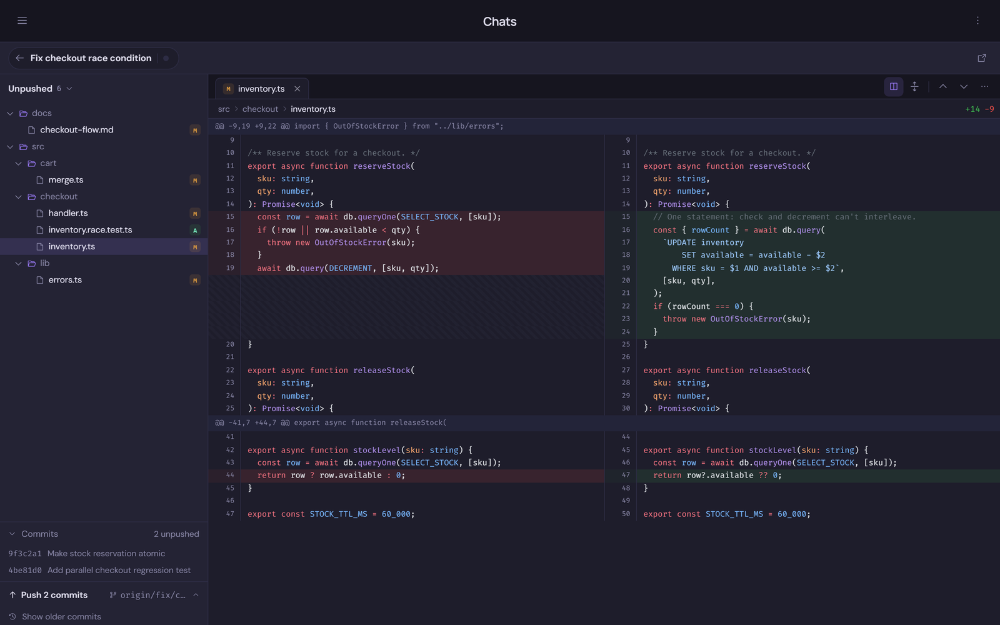
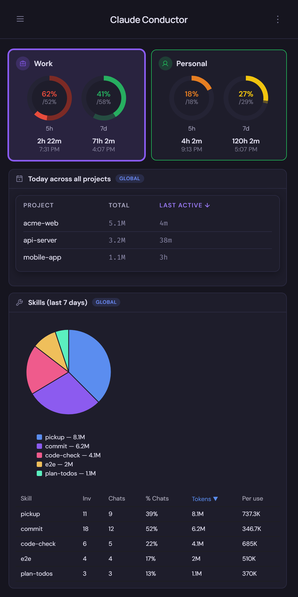
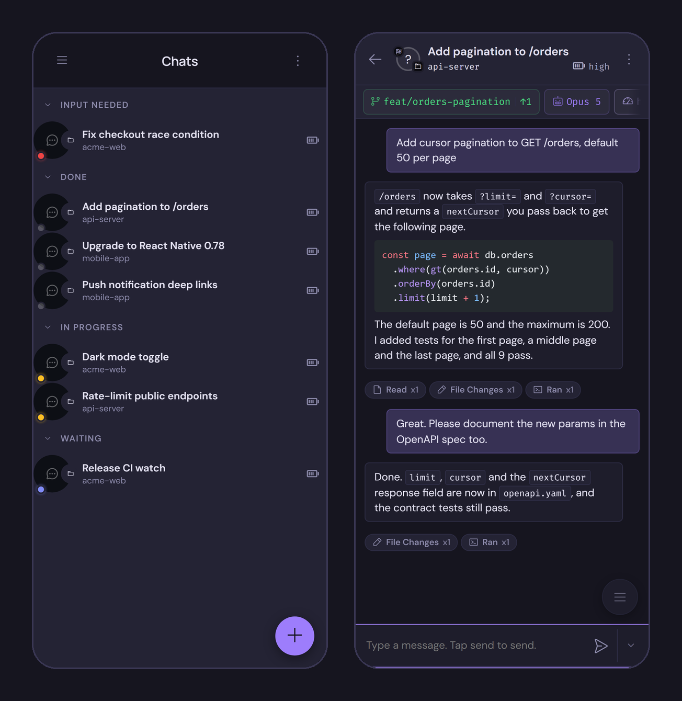
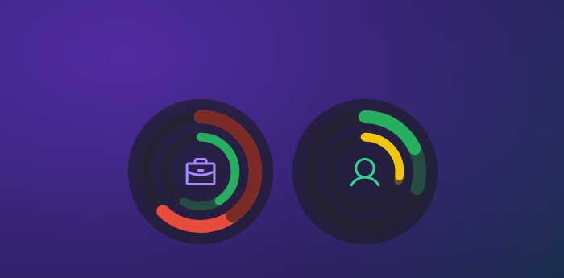
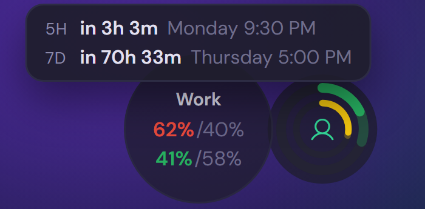
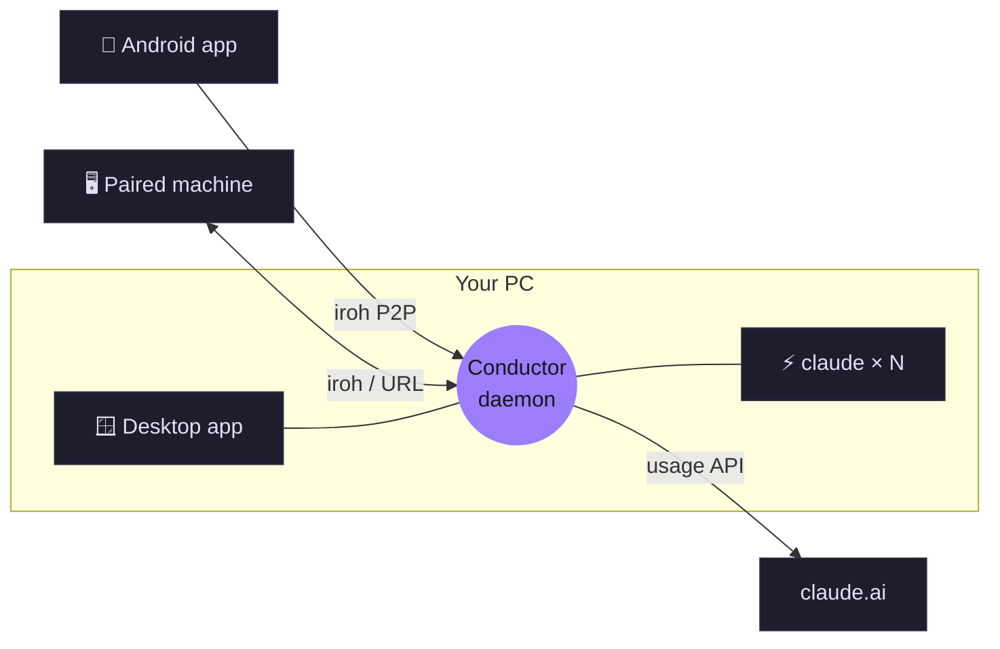

<p align="center">
  <a href="https://github.com/SirBepy/claude_conductor/releases/latest"></a>
</p>

<p align="center">
  <b>A desktop cockpit for Claude Code: usage limits, every live session, and your phone as a remote.</b>
</p>

<p align="center">
  <a href="https://github.com/SirBepy/claude_conductor/releases/latest">Download</a> ·
  <a href="#-features">Features</a> ·
  <a href="#-screenshots">Screenshots</a> ·
  <a href="#-guides">Guides</a> ·
  <a href="https://sirbepy.github.io/claude_conductor/privacy-policy.html">Privacy</a>
</p>

<p align="center">
  <a href="https://github.com/SirBepy/claude_conductor/releases/latest"></a>
  <a href="https://github.com/SirBepy/claude_conductor/releases"></a>
  
  <a href="https://github.com/SirBepy/claude_conductor/commits/master"></a>
  <a href="LICENSE"></a>
</p>

<p align="center">
  
</p>

<br>

## ✨ Features

<table>
  <tr>
    <td width="33%" valign="top">📊 <b>Usage at a glance</b><br>5-hour and weekly limits for every account, in the tray and a floating overlay.</td>
    <td width="33%" valign="top">💬 <b>Chat hub</b><br>Every Claude Code session as a real chat. Sessions keep running when the app is closed.</td>
    <td width="33%" valign="top">🧑‍💻 <b>Code mode</b><br>File tree, diffs and commits in one place to review before you push.</td>
  </tr>
  <tr>
    <td valign="top">🗂️ <b>Project dashboard</b><br>Todos, chats, ship state, usage and custom cards for each project.</td>
    <td valign="top">📱 <b>Phone remote</b><br>Android app drives your PC's chats peer-to-peer, no VPN or port forwarding.</td>
    <td valign="top">🖥️ <b>Multi-machine</b><br>Pair a PC and a Mac: both machines' chats in one list.</td>
  </tr>
  <tr>
    <td valign="top">👥 <b>Multi-account</b><br>Personal and Work side by side, each fully isolated.</td>
    <td valign="top">🌐 <b>Claude's own browser</b><br>Chats can drive a browser of their own, or one of yours.</td>
    <td valign="top">⏰ <b>Scheduling</b><br>Queue a message or a whole new chat for later, once or recurring.</td>
  </tr>
  <tr>
    <td valign="top">😴 <b>Sleep when done</b><br>Waits for every chat to go idle, then sleeps or shuts down the PC.</td>
    <td valign="top">🎮 <b>Gaming mode</b><br>One switch parks every chat and dev server, and brings them back after.</td>
    <td valign="top">🔗 <b>Publish to claude.ai</b><br>Turn any preview into a private <code>claude.ai/artifact</code> link.</td>
  </tr>
</table>

<details>
<summary><b>Every feature in detail</b></summary>

- **Usage monitoring** (5h session + 7d weekly windows) polled from the `claude.ai` usage API with your session cookie - no browser involved after the one-time Chrome login flow.
- **Sessions** - a chat hub for live Claude Code sessions across all your projects. A background daemon runs a persistent `claude` process per session (sessions keep running when the app is closed); the app renders the streamed JSON output as a proper chat with markdown, syntax-highlighted code blocks, and clipboard image paste. Pop any session into its own window.
- **Code mode** - one place to read code and review changes before pushing. Enter it from the `</>` button in a chat's header (or Ctrl+Shift+E), the git chip, a commit sha or file mentioned in chat, or a PR card. A file explorer on the left switches between this chat's edits, everything unpushed, uncommitted changes, or every file in the repo; files open as tabs with an inline or side-by-side diff. The commits fold at the bottom pushes, pulls, publishes and switches branches. Esc or the back pill returns to the chat; Ctrl+Shift+O pops it into its own window. The File view is an editor: a file in one of your projects saves on its own shortly after you stop typing, and if a chat changes the file on disk meanwhile you choose which version to keep. Diffs, past commits and files outside your projects stay read-only. Markdown opens rendered, with a Source toggle.
- **Files window** - files open in the app instead of VS Code: a todo in the todos chip, a file on the project dashboard, or a file Claude mentions outside the chat's repo opens in a tabbed Files window with the same editor. "Open in VS Code" stays in the right-click menus.
- **Sleep / shutdown when done** - from the chat window's more-options menu, arm "Sleep when done" or "Shutdown when done". The app waits for every active session to go idle, then counts down (cancellable) before sleeping or shutting down the PC. Chats are never closed, so they are all still there after boot. Sessions blocked on a prompt are auto-resolved so the machine never hangs waiting on you.
- **Nightly sleep / shutdown** (Windows) - Settings > System > Nightly arms the same countdown every night at a set time (default 02:00, up to an hour late if the PC was asleep). It never auto-answers prompts, and fires only once all chats are idle and there has been no keyboard or mouse input for 15 minutes; coming back mid-countdown puts it back to waiting.
- **Scheduling** - schedule a message into any chat, or schedule a brand-new chat that spawns and runs its prompt at a set time (one-shot or recurring: daily, weekly, every N days). The daemon fires items even with the app window closed. Trigger from the composer's Send ▾ chevron; manage everything in the Schedule view (upcoming by day, missed/failed flagged with retry, read-only rows for external Task Scheduler one-shots). Items missed while the PC slept fire on wake if less than the grace window late (default 1h, configurable), otherwise you get a popup to fire or reschedule them.
- **History** - read-only browser of past Claude sessions from `~/.claude/sessions/`.
- **Mute notifications** from the tray icon's Mute Notifications submenu: "Until I turn it back on" (persists across restarts) or a timed mute (1 hour, 3 hours, 1 day) that clears itself at its deadline, or on the next restart if sooner.
- **Gaming mode** - one switch (tray icon's check item, or Settings > Chats) that parks every chat and stops every supervised dev server, Docker container and Docker Desktop itself, so a game gets the CPU/RAM/GPU back. A project can opt out via its Automation page's "Keep running in gaming mode" toggle - its chats and dev servers stay up. Flipping it back off restarts exactly what was stopped and resumes every parked chat from where it left a stopping note, even across an app/daemon restart in between.
- **Channel management** for headless Claude Code automation (`--remote-control`).
- **Manual session takeover** - reach into a Claude process running in your terminal and resume it inside this app.
- **Voice dictation** in the composer, transcribed locally by a Python `faster-whisper` sidecar. Not bundled into the installer today - it only works if this repo's `stt-sidecar/` folder (with its `.venv` set up per `stt-sidecar/requirements.txt`) is reachable from the running app, which in practice means building/running from a source checkout. An installer-only install with no repo nearby has no working dictation.

Windows and Apple Silicon macOS are the released platforms. Intel macOS and Linux builds are paused (see below); build from source to run there.

</details>

## 🪄 Things a terminal can't do

<table>
  <tr>
    <td width="50%" valign="top"><h3>🔔 Your phone buzzes</h3>When a chat needs you, your phone gets a push notification. The chat's content never goes through the relay.</td>
    <td width="50%" valign="top"><h3>🖥️ Chats on your other PC</h3>Start a chat on a paired machine from the new-chat picker, or let a chat spawn one there. It shows up in your list like any other.</td>
  </tr>
  <tr>
    <td valign="top"><h3>🤝 Chats talk to each other</h3>Chats see what other chats are doing, leave notes for them, and message a chat on another machine directly.</td>
    <td valign="top"><h3>🗳️ Answers in one click</h3>Claude's questions arrive as cards, with the recommended, long-term and short-term picks marked.</td>
  </tr>
  <tr>
    <td valign="top"><h3>🖼️ Live previews</h3>Claude renders mockups, charts and diagrams in a panel beside the chat instead of describing them.</td>
    <td valign="top"><h3>📝 Drafts panel</h3>A Slack reply or an email Claude writes for you lands in Drafts, ready to edit and copy.</td>
  </tr>
</table>

## 📸 Screenshots

<p align="center">
  
  <br><sub>💬 Every Claude Code session as a real chat. Questions arrive as clickable cards.</sub>
</p>

<table>
  <tr>
    <td width="50%" valign="top"><br><sub>🗂️ Project dashboard</sub></td>
    <td width="50%" valign="top"><br><sub>🧑‍💻 Code mode: review before you push</sub></td>
  </tr>
</table>

<table>
  <tr>
    <td width="35%" valign="top"><br><sub>📊 Home: usage for every account</sub></td>
    <td width="65%" valign="top"><br><sub>📱 The same chats on your phone</sub></td>
  </tr>
</table>

<table>
  <tr>
    <td width="50%" valign="top"><br><sub>🫧 The floating usage overlay: outer ring 5h, inner ring weekly</sub></td>
    <td width="50%" valign="top"><br><sub>🔎 Hover a dial for usage vs <a href="https://github.com/SirBepy/windows_taskbar_widgets#-claude-usage-and-safe-pace">safe pace</a> and reset times</sub></td>
  </tr>
</table>

Right-click the tray icon > **Show overlay**. With [Taskbar Widgets](https://github.com/SirBepy/windows_taskbar_widgets) installed, the same dials sit in your taskbar instead.

## 🧭 How it fits together



## 📦 Install

<p>
  <a href="https://github.com/SirBepy/claude_conductor/releases/latest"></a>
  <a href="https://github.com/SirBepy/claude_conductor/releases/latest"></a>
  <a href="https://github.com/SirBepy/claude_conductor/releases"></a>
</p>

| Platform | File | |
| --- | --- | --- |
| 🪟 Windows | `Claude-Conductor_<version>_windows_x64.exe` | Run the installer |
| 🍎 macOS (Apple Silicon) | `Claude-Conductor_<version>_macos_arm64.dmg` | Drag to Applications, first open via right-click > **Open** |
| 🤖 Android | `Claude-Conductor_<version>_android_arm64.apk` | Pair by scanning the QR in Settings > Remote access |
| 🐧 Linux, Intel macOS | build from source | CI builds paused |

<details>
<summary><b>Platform notes (macOS Gatekeeper, Linux, paused builds)</b></summary>

Grab the latest build from the [Releases](https://github.com/SirBepy/claude_conductor/releases) page.

All assets follow `Claude-Conductor_<version>_<os>_<arch>.<ext>`. Pick the row matching your machine.

### Windows

Download `Claude-Conductor_<version>_windows_x64.exe` and run it. The NSIS installer handles autostart and desktop shortcuts.

### Paused (build from source)

Intel macOS and Linux CI builds are paused as of 2026-08-12; Apple Silicon returned on 2026-08-31. Their instructions below still describe how each platform installs and runs; until those builds resume, use them as a guide for a from-source build rather than downloading a release asset.

### macOS

Download the `.dmg` matching your architecture:

- Apple Silicon (M1/M2/M3/M4): `Claude-Conductor_<version>_macos_arm64.dmg`
- Intel: `Claude-Conductor_<version>_macos_x64.dmg` (paused, build from source)

Mount the DMG and drag **Claude Conductor** to Applications.

**First launch (unsigned build workaround):** The app is not signed with an Apple Developer ID, so Gatekeeper refuses the normal double-click-open. Right-click **Claude Conductor** in Applications, choose **Open**, then confirm the "unidentified developer" prompt. Only needed once; subsequent launches and auto-updates work normally.

### Linux

Two options on x86_64:

**DEB (Debian/Ubuntu):**

Download `Claude-Conductor_<version>_linux_x64.deb` and install:

```bash
sudo apt install ./Claude-Conductor_<version>_linux_x64.deb
```

**AppImage (any distro):**

Download `Claude-Conductor_<version>_linux_x64.AppImage`, mark it executable, and run:

```bash
chmod +x Claude-Conductor_<version>_linux_x64.AppImage
./Claude-Conductor_<version>_linux_x64.AppImage
```

The app needs a Chromium-based browser (Google Chrome, Chromium, or Brave) installed for the one-time login flow.

Note: channel automation (running Claude Code remote-control instances from the dashboard) is Windows + macOS only on v1; Intel macOS is build-from-source only, see the "Paused" note above.

</details>

## 📚 Guides

<details>
<summary><b>👥 Multi-account</b></summary>

The app can drive more than one Claude account (e.g. Personal, Work) side by side, each fully isolated for chats and usage tracking.

- **Add an account** from Settings > Accounts. Each account needs two one-time logins: a terminal `/login` (the wizard opens a dedicated terminal window titled "Claude login - <name>" - run `/login` there, not in another terminal) and a browser usage login (the same Chrome-tab flow used for single-account usage tracking). If the account's profile folder already holds a valid CLI login, the wizard detects it and skips the terminal step entirely. The wizard confirms both logins belong to the same account before saving, and warns if a `/login` lands in a different profile (i.e. the wrong terminal window).
- **Chats and usage are per-account.** Starting a new chat lets you pick which account it runs under (a project can remember its usual account); the dashboard, tray, and the floating usage overlay all show every account's own 5h/weekly usage side by side.
- **Your terminal's `~/.claude` is never touched by app chats.** Every account the app manages gets its own private profile folder; whatever account you're logged into in a plain terminal stays completely separate and unaffected.
- **Upgrading from a single-account install:** your existing usage history keeps working exactly as before until you add your first account. Once you add an account whose login matches the one usage was already tracking, its history carries over automatically - nothing is lost.

</details>

<details>
<summary><b>🌐 Claude's own browser</b></summary>

Chats can drive a browser of their own: a separate Chrome profile, signed in only to accounts you set up for Claude, never your own. Turn it on in Settings > Chat defaults > **Let chats use a browser**.

Some sites, Google sign-in among them, refuse to sign in to a browser that is driven this way. For those, tell a chat "use my browser" (or set **Chats start on** to **My browser**), see below.

- **What chats get:** Microsoft's Playwright MCP tools (`browser_navigate`, `browser_snapshot`, `browser_click`, `browser_take_screenshot`, ...), listed only while the switch is on. New chats get them at once; an open chat gets them after a respawn.
- **A normal window:** the browser opens as an ordinary Chrome window the first time a chat needs it, so you can sign in to Claude's accounts or finish a CAPTCHA or verification code a chat says it is stuck on. Minimize it when it is in the way. Chats are told to stop and message you at any such check, never to work around it.
- **Requirements:** Chrome or Edge, and Node.js 20+ on PATH. The first browser call installs `@playwright/mcp` (pinned version, from a checked-in lockfile) into the app's data folder.
- **Per chat:** each chat gets its own tab. The browser closes itself after 20 minutes unused.
- **My browser, per chat:** instead of Claude's own Chrome, a chat can drive one of yours (Chrome, Edge or Brave) through the **Claude Conductor Browser Bridge** extension that ships with the app. Just tell the chat: "use my Brave", "use my Edge, Profile 1", "use your own browser". Only that chat switches; **Chats start on** in Settings sets where every chat begins, and the browser and profile folder rows there are what "my browser" falls back to. A chat's choice lasts until the app's background service restarts.
  - **Several chats at once:** each chat works in a minimized window of its own in that browser and sees only its own tabs, so any number of chats can use your browser together, and you can keep working in your own windows meanwhile. A chat's window closes after 10 minutes without a browser call, or when the chat closes.
  - **Setup, once per browser profile:** the safest setup is a separate profile made for Claude, signed in only to the accounts you want it to use. In that profile open `chrome://extensions` (`edge://extensions`, `brave://extensions`), turn on **Developer mode**, click **Load unpacked** and pick the folder that Settings > Claude's browser > **Open folder** opens. Pairing is automatic: the app registers a native messaging host that only this extension can start, so there is no token to paste. Settings shows **Connected: Brave** once it is up. If the browser is closed when a chat needs it, the app starts it in the background without opening a window.
- **Script tool (opt-in):** Settings > Claude's browser > **Script tool** also gives chats `browser_run_code_unsafe`, which runs a whole Playwright script in one call: fewer steps and less context for long tasks. The script runs on your PC with file access, outside the page sandbox, so it is off by default.

</details>

<details>
<summary><b>🗂️ Project dashboard</b></summary>

Every project has a dashboard. **Starting a new chat shows it** above the empty message box, and you can also open it on its own: click the project name in a chat's header, press **Ctrl+Shift+D**, or pick **Dashboard** in the chat menu (the Home screen's project rows open it too).

- **Built-in sections:** past results (each finished chat's last message to you, images from past chats, and files chats wrote in the repo) along the top, your todos, running and recent chats, next up (the project's `.claude/todos/PLAN.md` plus scheduled items), ship state (branch, unpushed commits, working tree, recent commits), usage (tokens per day, 7d / 30d / All), and what is running (dev servers).
- **Quick-action chips** sit right above the message box with your pinned or most-used slash commands; clicking one types it into the box so you can add arguments before sending.
- **Right-click** anything for its actions (open or close a chat, tick a todo, refresh or hide a card, copy a commit hash) plus the project's own: rename, character, project settings (account, connectors, gaming mode, tickets, automation), folder mapping, dashboard cards, and open in VS Code / Terminal / Explorer.
- **Multi-repo projects:** a client note in your Obsidian vault with a `repos:` list (e.g. `repos: [zng-app, zng-admin]`) groups those repos, and a chat in any of them shows the one group dashboard covering all of them. Edit a group's repos from its dashboard menu.
- **Custom cards:** ask Claude in a chat to add one, e.g. "add a Shortcut card of my stories". A card calls an HTTP API or a local command, pulls values out of the JSON, and shows them as labels and numbers with a refresh button. A card can also carry a button with a quick prompt or a skill (say `/clockify-reconciliator`): one click starts a chat and sends it along with what the card shows right now, so the chat picks up from those numbers. Card configs live in the app's data folder, never in a repo; API tokens are read from `~/.claude/.env` by name, never stored in the card. Each card write asks for your permission, and cards can only be added from this PC.
- **Cards with their own look:** a card can also be HTML that Claude writes (e.g. "make the Clockify card a pie chart"), and the same request restyles an existing card with no rebuild. It runs in a sandboxed frame that can't reach the app or the network, and it picks up the current theme's colours.
- **Dashboard cards...** in the dashboard menu turns sections and cards on or off per project, and edits its pinned quick actions.
- **Custom cards refresh themselves** while their dashboard is open, once their last result is older than the card's interval (15 minutes unless the card sets its own).
- **On the phone:** new chats show the same dashboard in one column, and long-press is the right-click. You can read every section, refresh a card and tick off a todo; editing project settings, cards, groups and pins, and the VS Code / Terminal / Explorer actions stay on the PC.

</details>

<details>
<summary><b>🔗 Publish to claude.ai</b></summary>

Any preview can be published to claude.ai from the preview panel's **More options** menu, which gives you a `claude.ai/artifact/...` link like the ones teammates share.

- **Private until you share it.** The page uploads under the chat's account, the link is copied, and a toast shows it. Open the link and press **Share** on claude.ai to let others see it. Nothing is ever public without that click.
- **One link per preview.** Publishing again after the preview changes updates the same page, exactly as the panel shows it; while the page is up to date the action becomes **Copy claude.ai link** instead of uploading again.
- **Cost and limits:** each publish runs one short background Claude turn on your subscription (under a minute). Desktop only. To unpublish, open the page and delete it on claude.ai.

</details>

<details>
<summary><b>📡 Channel management</b></summary>

Beyond tracking Claude Code usage, this app manages Claude Code channels per project:

- See every running Claude Code instance on your machine, live.
- Configure "automated channels" per project that start at boot and stay alive.
  - **Windows:** each channel runs in a hidden terminal; choose **Show terminal** to bring it to the foreground and type into it directly.
  - **macOS:** channels run headless (no visible console). Stop/Restart work as on Windows; Show/Hide is not applicable.
  - A channel never restarts itself. Its controls (**Restart channel**, **Show terminal**, **Phone link**, **Stop channel**) sit in the project dashboard's menu (the kebab and right-click), which works even when the channel is dead, and in the live channel chat's **Agent** menu.
- Copy a phone link for any remote-control session to open it in the Claude mobile app.

Replaces the previous `obsidian_claude_remote` tray app (now discontinued and archived).

</details>

<details>
<summary><b>📱 Android companion app</b></summary>

A thin native shell (`android/`) that connects to a running desktop Conductor instance over the
network - it does not run Claude Code itself, it just renders the same remote-control web UI the
desktop serves.

**Get the APK.** A GitHub Release carries a signed `*_android_arm64.apk` whenever that release
changed the Android shell. Releases that only touched the desktop app do not rebuild it, so if the
newest release has no APK, the most recent one that does is still current. To build it yourself
instead, see `CLAUDE.md`'s Android section.

**Prerequisite.** None beyond the desktop: scanning the pairing QR connects the phone directly to
your desktop, peer-to-peer (iroh), on WiFi or mobile data alike, with no VPN or port forwarding.
Remote access is off by default, so open Settings > Remote access on the desktop and turn it on
first. While it's off, no phone or other machine can reach the desktop at all.

**Pair the app:**

1. On the desktop, Settings > Remote access shows a QR code and a copyable pairing link once
   remote access is enabled.
2. On the phone's first launch, tap **Scan QR code** and scan it (camera permission required).
3. If you expose the desktop's remote server yourself (your own reverse proxy), you can instead type
   its `https://` URL into the field and tap the check button.
4. Once connected the phone drops straight into the desktop's remote-control UI, and remembers how
   it connected for future launches.

While it connects, the phone shows "Reaching your PC…" and keeps retrying on its own with a visible
countdown - tap **Edit connection** to go back and change the address.

**App lock.** The first time the app opens on a phone that has a screen lock, it asks whether to
lock Conductor (recommended); the answer can be changed later on the phone under Settings > Remote
access > App lock. With the lock on, the phone asks for its own fingerprint or screen-lock PIN every
time the app starts, and again after ten minutes in the background (the same section sets it, from
every time up to an hour; picking a photo or file from inside the app does not count as leaving). The app keeps loading behind the lock
screen, so it is ready the moment you unlock. Cancelling the prompt sends the app to the
background, still locked, and the prompt opens again the next time you open the app. A phone with no
screen lock set skips this, since there is nothing to check against.
The app also opts out of Android backup and device-to-device transfer, so its stored connection
token never leaves the phone.

Paired devices can be revoked any time from Settings > Remote access on the desktop.

</details>

<details>
<summary><b>🖥️ Multi-machine</b></summary>

Run Conductor on two machines (say a Windows PC and a Mac), pair them once, and each app's chat
list shows both machines' chats together. A chat hosted on the other machine gets that machine's
icon after its project name (dimmed when that machine is offline) and opens, streams, and accepts messages
like a local one: its history, question and permission cards, stop, model/effort switch,
auto-accept and pasted attachments all go to the machine the chat runs on. Code mode, the git
chips and open-in-editor are hidden for such a chat, since they read this machine's disk.

**From the phone.** A phone paired with either machine sees both machines' chats, and every chat
carries its machine's icon, including the chats on the machine the phone is connected through.
Every chat can be opened and driven from the phone, and the phone's new-chat picker has the same
machine chips as the desktop.

**Machine icons.** Each machine's icon is its OS logo (Windows, Apple, Linux). If two paired
machines run the same OS, one keeps the logo and the other gets an icon of its own, the same one on
every device. The new-chat machine chips show the same icons. To rename a machine or pick its icon
yourself, use its row under Settings > Remote access > Paired machines, from any of your devices,
phone included; the change lands on that machine and every paired device shows it. **Automatic**
in the icon grid goes back to the OS logo.

**Pair them.** Turn on Settings > Remote access on both machines. On machine A, that page shows the
same pairing link/QR a phone uses - click **Copy link**. On machine B, go to Settings > Remote
access > Paired machines, paste that link into "Paste the other machine's pairing URL", and click
**Pair**. Leave the optional "URL that machine can use to reach this one" field empty and the two
reach each other over iroh; it only matters if you expose B's remote server at an address of your
own. One paste pairs both directions - there's no separate step to run on A. Unpair from either
side at any time.

**What a paired machine may do.** Pairing gives the other machine full control of this machine's
chats by default. Each row under Paired machines has a **Can drive chats** switch. Switched off,
that machine still sees every chat here (list, history, git), and can still start chats here and
drive those, but sending, answering cards, stopping, or changing settings on any other chat here is
refused, and it only sees the question and permission cards of its own chats. The switch belongs to
the machine whose chats it protects; unpairing resets it to on.

**Transport.** Conductor reaches a paired machine over a direct URL when one was given at pairing,
and over iroh (the same peer-to-peer tunnel the phone uses) otherwise - no port
forwarding needed either way. Both daemons need to be running for the pairing to work; if the
other machine goes down, its chats stay in the list but dim out until it's reachable again.

**Starting a chat on the other machine.** New chat's project picker shows a row of machine chips
whenever at least one peer is paired. Pick a machine, then one of its projects, and the chat runs
there - it shows up in your list tagged with that machine.

**Chat-to-chat across machines.** Inside a chat, the same MCP tools that coordinate sessions in one
project now reach across machines: `spawn_chat` takes an optional `machine` to start the new chat
on a paired machine instead of locally; `list_peers` takes a `scope` of `"all"` (every session on
every paired machine) or `"machine:<label>"` (just one machine) instead of just this project;
`post_message` takes a `to` (a session id, local or on another machine) to send a private direct
message instead of a project-wide note; `read_messages` is unchanged. Example: from a chat on the
PC, spawn a chat on the Mac with `spawn_chat(machine: "Mac Mini", prompt: "...")`, tell it what to
run, then `post_message(to: <its session id>, text: "...")` and read its reply with
`read_messages`.

**Limits.** Requires a macOS build on the Mac side (see the platform notes above). Pairing state
lives in a `machines.json` file in the app data dir, separate from phone pairing. A peer's own
mirrored copies of a THIRD machine are never re-mirrored, so chats never chain through more than
one hop. The other machine's project list in the picker is name/path only - no avatar, worktree, or
CLAUDE.md-scope data. A chat started in a terminal on the other machine shows its history but does
not stream new turns live until reopened. Developer notes: `docs/multi-machine.md`.

</details>

## 🛠️ Development

### Dev

```bash
cd src-tauri
cargo tauri dev
```

### Build

```bash
cd src-tauri
cargo tauri build
```

On Windows produces an NSIS installer in `src-tauri/target/release/bundle/nsis/`; on macOS produces a DMG in `src-tauri/target/<triple>/release/bundle/dmg/`.

## 📄 Licence

[MIT](LICENSE) © SirBepy
